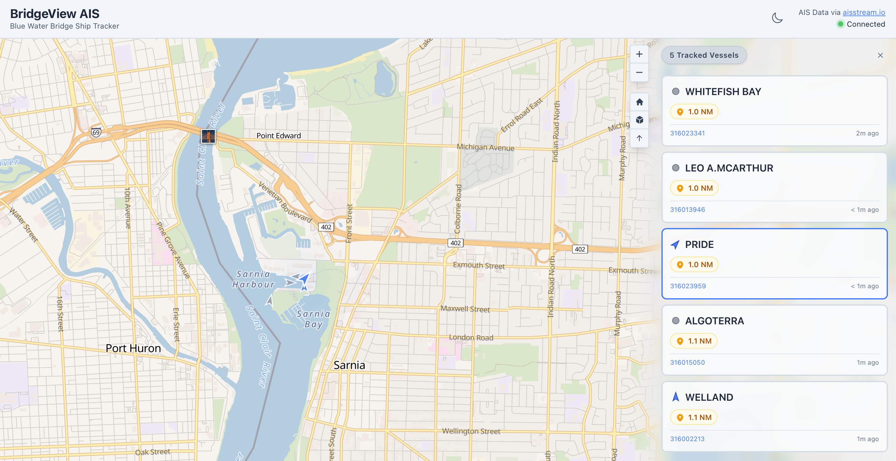

# BridgeView AIS


A real-time ship tracking application that displays vessel traffic near the Blue Water Bridge using Automatic Identification System (AIS) data.

<picture>
  <source srcset="img/darkmode.png" media="(prefers-color-scheme: dark)">
  
</picture>

## 🔍 Overview

BridgeView AIS is a web-based maritime tracking tool that provides live visualization of ship movements and detailed vessel information. Built with modern web technologies, it offers an intuitive interface for monitoring shipping activity in the Blue Water Bridge area.

## ✨ Features

- **Real-time Ship Tracking**: Live AIS data streaming via WebSocket for up-to-the-second vessel positions
- **Interactive Map**: MapLibre GL-powered map with smooth rendering via react-map-gl
- **Vessel Details**: Comprehensive ship information including:
  - Vessel name and navigation status
  - Current speed, course, and heading
  - Destination and estimated time to bridge
  - MMSI identification
- **Dark/Light Theme**: Toggle between dark and light modes
- **Modern UI**: Built with Tailwind CSS and Headless UI for a clean, responsive interface
- **Notification System**: Real-time approach and close-approach alerts
- **Error Boundaries**: Graceful error handling with component-level and app-level boundaries
- **Secure WebSocket Proxy**: Rate limiting, authentication support, and input validation

## 🛠️ Tech Stack

- **Frontend**: [React](https://github.com/facebook/react) 19 + [TypeScript](https://github.com/microsoft/TypeScript)
- **Build Tool**: [Vite](https://github.com/vitejs/vite)
- **Mapping**: [MapLibre GL JS](https://github.com/maplibre/maplibre-gl-js) via [react-map-gl](https://github.com/visgl/react-map-gl)
- **Styling**: [Tailwind CSS](https://github.com/tailwindlabs/tailwindcss)
- **UI Components**: [Headless UI](https://github.com/tailwindlabs/headlessui)
- **Icons**: [Heroicons](https://github.com/tailwindlabs/heroicons)
- **Testing**: [Vitest](https://github.com/vitest-dev/vitest) + [React Testing Library](https://github.com/testing-library/react-testing-library)
- **WebSocket**: [ws](https://github.com/websockets/ws)
- **Data Source**: Real-time AIS data from [AISStream.io](https://aisstream.io)

## 🚀 Getting Started

### Prerequisites

- Node.js (v26 or higher)
- npm

### Installation

1. Clone the repository:

```bash
git clone https://github.com/tmcknight/bridgeview-ais.git
cd bridgeview-ais
```

2. Install dependencies:

```bash
npm install
```

3. Set up environment variables:

```bash
cp .example.env .env
```

Add your AISStream.io API key to the `.env` file (see `.example.env` for all options).

4. Start the development server:

```bash
npm run dev
```

This command starts both the WebSocket proxy server (port 3001) and the Vite development server (port 5173). The application will be available at `http://localhost:5173`.

### Docker

Alternatively, you can run the app with Docker:

```bash
cp .example.env .env
# Edit .env and set AISSTREAM_API_KEY
docker compose up --build -d
```

The application will be available at `http://localhost:3000`. See [infra/DOCKER.md](infra/DOCKER.md) for full details.

## 👨‍💻 Development

This project was built using React, TypeScript, and Vite, with hot module replacement (HMR) for a smooth development experience.

### Available Scripts

- `npm run dev` - Start both the WebSocket proxy server and Vite development server
- `npm run server` - Start only the WebSocket proxy server
- `npm run build` - Build for production
- `npm run preview` - Preview the production build
- `npm run lint` - Run ESLint
- `npm test` - Run tests in watch mode
- `npm run test:run` - Run tests once
- `npm run test:coverage` - Run tests with coverage report
- `npm run test:ui` - Run tests with interactive UI

## 🏗️ Architecture

The application consists of:

- **React frontend**: Handles UI rendering and user interactions
- **WebSocket proxy server** (`server/server.js`): Secure proxy to AISStream.io with rate limiting, authentication, and input validation
- **MapLibre GL via react-map-gl**: High-performance interactive map visualization with 3D support
- **Component architecture**: Modular design with ShipMap, ShipList, NotificationPanel, StatusBar, and ErrorBoundary components
- **Custom hooks**: `useAISStream` for WebSocket management, `useTheme` for dark/light mode

## 📡 Data Source

This application is made possible by [AISStream.io](https://aisstream.io), a free service that provides real-time AIS (Automatic Identification System) data via WebSocket connections. AISStream.io aggregates data from a global network of AIS receivers and makes it accessible to developers building maritime tracking applications.

Special thanks to AISStream.io for providing free access to live vessel tracking data.

### Local SDR receiver (optional)

The proxy can also take AIS straight off the air from an RTL-SDR dongle (e.g. a Nooelec NESDR SMArt) running [AIS-catcher](https://github.com/jvde-github/AIS-catcher):

```bash
AIS-catcher -d:0 -gr TUNER auto -S 5012 MSGFORMAT JSON_FULL
```

Set `AIS_SOURCE` in `.env` to choose the feed:

- `both` (default): merge AISStream.io and the local receiver, dropping duplicate transmissions
- `local`: local receiver only (no API key needed)
- `aisstream`: AISStream.io only

`LOCAL_AIS_HOST` / `LOCAL_AIS_PORT` point at AIS-catcher (default `127.0.0.1:5012`). The proxy reconnects automatically if AIS-catcher restarts. Set `LOCAL_AIS_WEB_URL` to AIS-catcher's web view (started with `-N 8100`) to link it from the sources menu.

## ℹ️ About

This project was mostly vibe coded with [Claude](https://claude.ai) - an AI assistant by Anthropic. The development process leveraged AI-assisted coding to rapidly prototype and build features, resulting in a functional maritime tracking application.

## 📖 Documentation

- [infra/DOCKER.md](infra/DOCKER.md) - Docker containerization setup and usage
- [TESTING.md](TESTING.md) - Comprehensive test documentation and coverage details
- [SECURITY.md](SECURITY.md) - Security policies and vulnerability reporting
- [CONTRIBUTING.md](CONTRIBUTING.md) - Contribution guidelines

## 📜 License

This project is licensed under the MIT License - see the [LICENSE](LICENSE) file for details.

## 🤝 Contributing

Contributions are welcome! Please see the [CONTRIBUTING.md](CONTRIBUTING.md) file for guidelines on how to contribute to this project.
